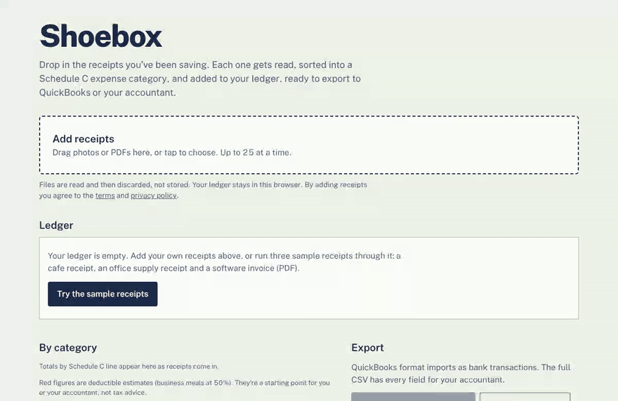

# Shoebox

Receipt photos and PDFs in, a categorized expense ledger out. Shoebox reads each receipt, files it under an IRS Schedule C category with a one-line reason, highlights the ones it's unsure about, and exports a QuickBooks-ready CSV. Built for freelancers and sole proprietors who do their own books.

**[Try the live demo](https://shoebox-taupe.vercel.app)**. No sign-up: click "Try the sample receipts" to run three sample receipts through it.



## Accuracy

Measured with the harness in [`api/eval`](api/eval/README.md): the production pipeline run over the public [SROIE](https://rrc.cvc.uab.es/?ch=13) scanned-receipt benchmark and hand-labeled receipts, scored field by field, with every miss listed in the report.

<!-- accuracy:start -->
No test set with at least 10 receipts has been run yet. See [api/eval](api/eval/README.md).
<!-- accuracy:end -->

## How it works

```
Browser (Next.js, TypeScript)                FastAPI (Python) on Render                 Claude
  downscale photo to 1600 px JPEG  --/api-->   validate type and size, rate limit  -->   vision + structured output
  ledger in localStorage            (Vercel    Pydantic normalizes the result     <--   JSON matching the schema
  CSV and QuickBooks export          proxy)    anonymous usage events in Postgres
```

- **Structured output by construction.** Each request carries a JSON schema (Claude's structured outputs) that lists the 17 allowed categories, so every reply is valid, typed JSON. Pydantic then normalizes dates, currency and confidence, and maps anything unexpected to "Other expenses" rather than failing.
- **Confidence drives review.** Low-confidence rows are highlighted, and a category change is one click. Every change is logged, so the share of categories nobody changed is a live accuracy signal alongside the offline eval.
- **Measured, not assumed.** The eval runs the exact production prompt and image preprocessing, caches predictions by prompt version so prompt changes can be compared cheaply, and reports 95% confidence intervals because 80 receipts is a small sample.
- **Honest usage numbers.** Sample-receipt tries are tagged and kept out of the user counts.
- **Cheap to run.** One origin for the browser (Vercel proxies `/api` to Render), per-client and daily caps on model calls, and nothing stored server-side except anonymous events.
